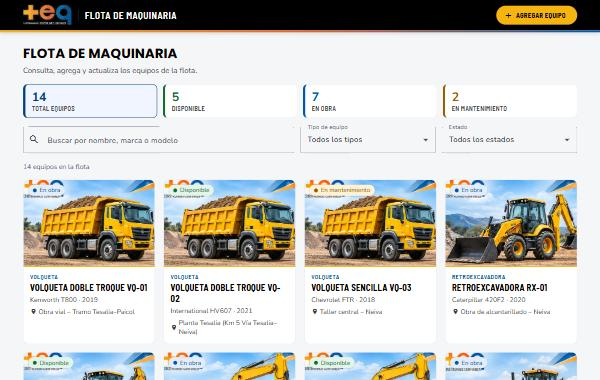
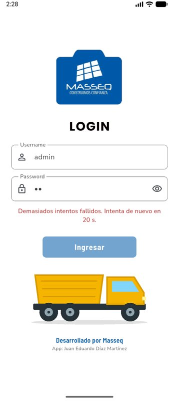
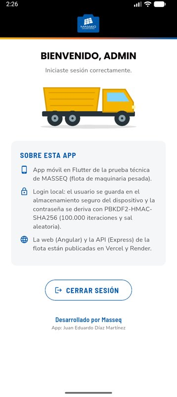

# MASSEQ · Flota de maquinaria

Prueba técnica para el cargo de **Desarrollador FrontEnd** en MASSEQ.

Aplicación para gestionar una flota de maquinaria pesada (volquetas, retroexcavadoras, excavadoras,
motoniveladoras, vibrocompactadores, cargadores, bulldozer, carrotanque y planta trituradora): listar,
buscar, ver el detalle, agregar, editar y eliminar equipos.

> Los datos son **de ejemplo**; no corresponden a la flota real de MASSEQ.



## Despliegue

| Parte | URL |
| --- | --- |
| Web (Vercel) | https://prueba-masseq.vercel.app |
| API (Render) | https://masseq-flota-api.onrender.com |
| App móvil (APK) | Adjunto en [GitHub Releases](../../releases) (`app-release.apk`) |

> **Nota sobre Render gratuito:** el servidor se duerme tras unos minutos sin uso; la primera petición
> puede tardar hasta un minuto (la web muestra el aviso *"Conectando con el servidor…"*). Además, el
> disco no es persistente: **los cambios (equipos creados, editados o eliminados) se pierden cuando el
> servidor se reinicia** y los datos vuelven a los 14 equipos iniciales de `data/seed.json`.

## Estructura del monorepo

```
backend/   API REST propia (Node + Express 5)
web/       Frontend web (Angular 21 + Angular Material)
mobile/    App móvil (Flutter): login MASSEQ
```

## Tecnologías

- **Backend:** Node.js 22, Express 5, CORS, helmet, express-rate-limit. Persistencia en archivo JSON (`data/db.json`).
- **Web:** Angular 21 (componentes standalone, signals, control flow `@if/@for`, zoneless),
  Angular Material 21 (tema M3 *azure*), formularios reactivos, `HttpClient` con `withFetch()`,
  rutas *lazy* con `withComponentInputBinding()`, `rxResource`.
- **Móvil:** Flutter 3.41 (Material 3), `flutter_svg`, `flutter_secure_storage`, `cryptography`, `flutter_launcher_icons`.
- **Despliegue:** Vercel (web) y Render (API).

## Cómo ejecutar en local

Requisitos: Node 22 y npm 10.

### 1. Backend (puerto 3000)

```bash
cd backend
npm install
npm run dev      # recarga automática; o "npm start"
npm run reset    # restaura data/db.json con los datos iniciales
```

### 2. Web (puerto 4200)

```bash
cd web
npm install      # el .npmrc incluye legacy-peer-deps
npm start        # ng serve → http://localhost:4200
npm run build    # compila a dist/web/browser
```

La web usa `http://localhost:3000` cuando corre en `localhost` y la API de Render en cualquier otro host
(ver `web/src/app/core/api.config.ts`).

## API

Modelo de un equipo:

```json
{
  "id": 1,
  "title": "Volqueta Doble Troque VQ-01",
  "type": "volqueta",
  "brand": "Kenworth",
  "model": "T800",
  "year": 2019,
  "capacity": "14 m³",
  "status": "en_obra",
  "location": "Obra vial – Tramo Tesalia–Paicol",
  "description": "…",
  "image": "/images/volqueta.jpg"
}
```

- `type`: `volqueta | retroexcavadora | excavadora | motoniveladora | vibrocompactador | cargador | bulldozer | carrotanque | trituradora`
- `status`: `disponible | en_obra | mantenimiento`
- `image` (opcional): URL `http(s)` o una imagen propia `/images/<nombre>.jpg|.svg`. Si se omite, se asigna la foto del tipo (`/images/<tipo>.jpg`).

| Método | Ruta | Descripción |
| --- | --- | --- |
| GET | `/api/machines?search=texto` | Lista los equipos (búsqueda opcional por nombre, marca o modelo, sin tildes) |
| GET | `/api/machines/:id` | Detalle de un equipo |
| POST | `/api/machines` | Crea un equipo (201) |
| PUT | `/api/machines/:id` | Reemplaza un equipo; sin imagen → foto del tipo |
| PATCH | `/api/machines/:id` | Actualiza parcialmente; si cambia el tipo y la imagen era una ilustración, se ajusta |
| DELETE | `/api/machines/:id` | Elimina un equipo (204) |
| GET | `/api/catalog` | Tipos y estados válidos |
| GET | `/api/health` | Estado del servicio |
| GET | `/images/<tipo>.jpg` | Foto por defecto de cada tipo de equipo |
| GET | `/images/<tipo>.svg` | Ilustración de respaldo de cada tipo |

Los errores de validación responden `400` con `{ "message": "...", "errors": ["..."] }` en español.

## Requisitos cumplidos (web)

- [x] **Inicio:** todos los equipos en cuadrícula (CSS grid) con imagen y título.
- [x] **Buscador** por nombre/título, que también busca marca y modelo y no distingue tildes.
- [x] Extra: **filtros por tipo y estado** y **contadores por estado** (clic para filtrar); los filtros se guardan en la URL.
- [x] **Detalle** al hacer clic en un equipo (`/maquinaria/:id`).
- [x] **Agregar** equipo (`/maquinaria/nueva`); aparece en el listado.
- [x] **Editar** equipo (`/maquinaria/:id/editar`); los cambios se ven en el listado y en el detalle.
- [x] **Eliminar** con diálogo de confirmación; desaparece del listado.
- [x] `MachineService` con `HttpClient` y un signal `machines` que se actualiza tras crear, editar o eliminar.
- [x] Formulario reactivo con validaciones y mensajes en español, y **vista previa** de la imagen.
- [x] Imágenes relativas (`/images/...`) resueltas contra la API; si una imagen falla se usa la foto del tipo (`.jpg`) y, si también falla, su ilustración (`.svg`).
- [x] Estados de **carga**, **error** (con reintentar) y **sin resultados**; aviso si la API tarda más de 3 s.
- [x] Diseño responsive con la identidad visual de MASSEQ (según web.masseq.com.co): azul `#0057A8`,
  amarillo `#F6B40E` (CTA), naranja `#E8642F`, encabezado negro con el logo, línea de acento con degradado
  amarillo→naranja→azul y pie oscuro *"MASSEQ | CONSTRUIMOS CONFIANZA"*. Tipografías Poppins (títulos),
  Barlow Semi Condensed (etiquetas y nombres) y Nunito Sans (texto). Tema de Angular Material generado con
  `ng generate @angular/material:theme-color` y contraste WCAG AA revisado.
- [x] Logo con fondo transparente generado por script (`web/scripts/make-brand-logo.py`).
- [x] `vercel.json` con *rewrites* para las rutas de la SPA.

## Móvil (Flutter)

App **MASSEQ Login** en `mobile/` (proyecto `juan_eduardo_diaz`, paquete `co.masseq.juan_eduardo_diaz`),
hecha con Flutter 3.41.7 (Dart 3.11).

| Login | Credenciales incorrectas | Bloqueo tras 5 intentos | Inicio |
| --- | --- | --- | --- |
|  |  |  |  |

*Capturas tomadas en el emulador de Android con el APK de release.*

**Credenciales de demo:** usuario `admin`, contraseña `Masseq2026*`.

### Qué incluye

- Réplica de la pantalla de login: insignia de MASSEQ (`assets/brand/logo-masseq-insignia.png`), título
  **LOGIN**, campos *Username* y *Password* con borde, botón **Ingresar** azul `#0057A8`, ilustración de la volqueta (recortada de `backend/public/images/volqueta.svg`, con
  `flutter_svg`) y el pie *"Desarrollado por Masseq"* / *"App: Juan Eduardo Díaz Martínez"*.
- Responsive y sin desbordes con el teclado (`SafeArea` + `SingleChildScrollView`, ancho máximo 380 px).
- **Bonus:**
  1. Contraseña enmascarada con `•` (`obscureText` + `obscuringCharacter`).
  2. Botón de ojo para mostrar u ocultar la contraseña.
  3. Login local con `flutter_secure_storage`: el usuario de demo se crea la primera vez que se abre la app y
     la contraseña se deriva con **PBKDF2-HMAC-SHA256** (100.000 iteraciones, sal aleatoria), nunca en texto
     plano. Mensajes en español (campos vacíos y *"Usuario o contraseña incorrectos"*, texto de error +
     `SnackBar`), bloqueo de 30 s tras 5 intentos; el botón se deshabilita y muestra un loader mientras valida. Si el login es
     correcto se abre la pantalla de inicio (*"Bienvenido, admin"*) con **Cerrar sesión**.
  4. Ícono propio generado con `flutter_launcher_icons` a partir de un PNG 1024×1024 compuesto por script
     con la insignia sobre azul `#0057A8` (`mobile/tool/generate_icon.py`, Pillow), con ícono adaptativo en
     Android. Nombre visible: **MASSEQ Login**.
- Identidad visual de MASSEQ: paleta de la marca y fuentes **Poppins**, **Barlow Semi Condensed** y
  **Nunito Sans** incluidas como assets (`mobile/assets/fonts`, licencia OFL), sin `google_fonts`: la app
  funciona sin internet.

Estructura: `lib/main.dart`, `lib/theme.dart`, `lib/screens/` (login e inicio),
`lib/services/auth_service.dart`, `lib/widgets/` (insignia y pie), `test/widget_test.dart`.

### Cómo ejecutar

```bash
cd mobile
flutter pub get
flutter run -d chrome        # web
flutter run                  # emulador o dispositivo Android
flutter analyze              # sin issues
flutter test                 # tests de widget del login
flutter build apk --release --obfuscate --split-debug-info=build/symbols  # APK en build/app/outputs/flutter-apk/
python tool/generate_icon.py && dart run flutter_launcher_icons   # regenerar el ícono
```

El APK de release se adjunta en **GitHub Releases**.

> **Nota de compilación en Windows:** el JDK que trae Android Studio es la versión 25, así que el proyecto
> usa Gradle 9.1 y AGP 8.13 (la plantilla de Flutter traía Gradle 8.14, que no soporta Java 25). Si la ruta
> del usuario tiene espacios y Gradle falla con `Unable to establish loopback connection`, define antes de
> compilar una carpeta sin espacios para los sockets de Java, por ejemplo en PowerShell:
> `$env:JAVA_TOOL_OPTIONS='-Djdk.net.unixdomain.tmpdir=C:\Users\Public'`.

## Seguridad

Revisión basada en el **OWASP Top 10:2025**.

### API (backend)

- **Cabeceras de seguridad** con `helmet` (CSP, HSTS, `nosniff`, `frame-ancestors`, sin `X-Powered-By`).
  `Cross-Origin-Resource-Policy: cross-origin` para que la web en Vercel cargue las imágenes.
- **CORS con lista blanca** desde la variable `ALLOWED_ORIGINS` (separada por comas). Por defecto:
  `https://prueba-masseq.vercel.app,http://localhost:4200`.
- **Rate limiting** (`express-rate-limit`, con `trust proxy` para Render): 300 peticiones / 15 min por IP en
  `/api` y 30 escrituras (POST/PUT/PATCH/DELETE) / 15 min. Responde `429` en español.
- **Cuerpos acotados:** `express.json({ limit: '10kb' })` → `413` si se supera; `415` si una escritura con
  cuerpo no envía `Content-Type: application/json`; `400` si el JSON está mal formado.
- **Tope de 200 equipos** (`409`) para que la demo no llene el almacenamiento.
- **Validación con lista blanca de campos:** solo se guardan los campos conocidos (no se puede inyectar `id`
  ni otros campos); tipos, estados, rangos y longitudes validados; imágenes solo `http(s)` o `/images/...`.
- **Errores sin trazas:** el cliente recibe mensajes genéricos en español; el detalle solo va al log.
- `npm audit`: backend sin vulnerabilidades. Web: dependencias de producción sin vulnerabilidades; quedan
  16 avisos *moderate* solo en herramientas de desarrollo del Angular CLI (`minimatch`/`tuf-js`), cuya
  única corrección propuesta es bajar el CLI a la v16 (rompe el proyecto), por lo que se dejaron.
- **Dependabot** (`.github/dependabot.yml`): actualizaciones semanales de npm (`/backend`, `/web`) y pub (`/mobile`).

### Web

- Cabeceras en `vercel.json`: **Content-Security-Policy** estricta (`script-src 'self'`, `connect-src` solo a
  la API, `frame-ancestors 'none'`…), `X-Content-Type-Options: nosniff`, `Referrer-Policy`,
  `Permissions-Policy` (cámara, micrófono y geolocalización desactivados), HSTS y `X-Frame-Options: DENY`.
- Para cumplir la CSP sin `'unsafe-inline'` en scripts se desactivó `inlineCritical` en el build de
  producción (Angular cargaba el CSS con un `onload` en línea, que la CSP bloquearía).
- Sin `innerHTML` ni `bypassSecurityTrust*` (Angular escapa todo el contenido) y sin secretos en el frontend.

### Móvil

- Usuario guardado con **`flutter_secure_storage`** (Android Keystore; en la web, Web Crypto).
- La contraseña nunca se guarda: se deriva con **PBKDF2-HMAC-SHA256** (paquete `cryptography`,
  100.000 iteraciones, sal aleatoria de 16 bytes) en un isolate aparte, y se compara en **tiempo constante**.
- **Mensaje genérico** *"Usuario o contraseña incorrectos"* (no revela si el usuario existe; también se
  deriva la clave cuando el usuario no existe para no filtrar información por tiempo de respuesta).
- **Bloqueo de 30 s tras 5 intentos fallidos**, con contador de intentos restantes y cuenta regresiva
  visibles; el bloqueo se mantiene aunque se cierre la app.
- `android:allowBackup="false"`, APK de release **ofuscado** (`--obfuscate --split-debug-info=build/symbols`)
  y sin `print` de datos sensibles.

### Limitación declarada

La **API de demo no tiene autenticación**: cualquiera puede crear, editar o eliminar equipos (mitigado solo con
rate limiting, validación y el tope de 200 equipos). El login de la app móvil es local y no protege la API.
El siguiente paso sería **autenticación con JWT y roles** (p. ej. `admin` para escribir y lectura pública),
con contraseñas con hash bcrypt y rutas protegidas en la web.

## Autor

Desarrollado por **Juan Eduardo Díaz Martínez**.
