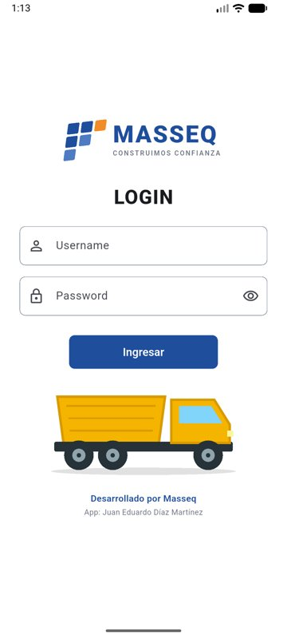
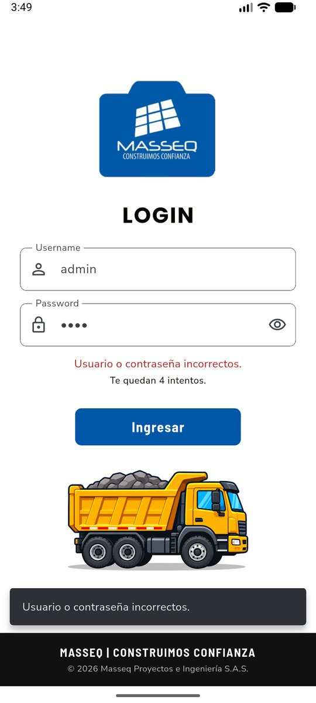

# MASSEQ · Flota de maquinaria

Prueba técnica para el cargo de **Desarrollador FrontEnd** en MASSEQ.

Aplicación para gestionar una flota de maquinaria pesada (volquetas, retroexcavadoras, excavadoras,
motoniveladoras, vibrocompactadores, cargadores, bulldozer, carrotanque y planta trituradora): listar,
buscar, ver el detalle, agregar, editar y eliminar equipos.

> Los datos son **de ejemplo**; no corresponden a la flota real de MASSEQ.

## Despliegue

| Parte | URL |
| --- | --- |
| Web (Vercel) | https://prueba-masseq.vercel.app |
| API (Render) | https://masseq-flota-api.onrender.com |
| App móvil (APK) | Adjunto en [GitHub Releases](../../releases) (`app-release.apk`) |

> **Nota sobre Render gratuito:** el servidor se duerme tras unos minutos sin uso; la primera petición
> puede tardar hasta un minuto (la web muestra el aviso *"Conectando con el servidor…"*). Además, el
> disco no es persistente: **los cambios (equipos creados, editados o eliminados) se pierden cuando el
> servidor se reinicia** y los datos vuelven a los 14 equipos iniciales de `data/seed.json`.

## Estructura del monorepo

```
backend/   API REST propia (Node + Express 5)
web/       Frontend web (Angular 21 + Angular Material)
mobile/    App móvil (Flutter): login MASSEQ
```

## Tecnologías

- **Backend:** Node.js 22, Express 5, CORS. Persistencia en archivo JSON (`data/db.json`).
- **Web:** Angular 21 (componentes standalone, signals, control flow `@if/@for`, zoneless),
  Angular Material 21 (tema M3 *azure*), formularios reactivos, `HttpClient` con `withFetch()`,
  rutas *lazy* con `withComponentInputBinding()`, `rxResource`.
- **Móvil:** Flutter 3.41 (Material 3), `flutter_svg`, `shared_preferences`, `crypto`, `flutter_launcher_icons`.
- **Despliegue:** Vercel (web) y Render (API).

## Cómo ejecutar en local

Requisitos: Node 22 y npm 10.

### 1. Backend (puerto 3000)

```bash
cd backend
npm install
npm run dev      # recarga automática; o "npm start"
npm run reset    # restaura data/db.json con los datos iniciales
```

### 2. Web (puerto 4200)

```bash
cd web
npm install      # el .npmrc incluye legacy-peer-deps
npm start        # ng serve → http://localhost:4200
npm run build    # compila a dist/web/browser
```

La web usa `http://localhost:3000` cuando corre en `localhost` y la API de Render en cualquier otro host
(ver `web/src/app/core/api.config.ts`).

## API

Modelo de un equipo:

```json
{
  "id": 1,
  "title": "Volqueta Doble Troque VQ-01",
  "type": "volqueta",
  "brand": "Kenworth",
  "model": "T800",
  "year": 2019,
  "capacity": "14 m³",
  "status": "en_obra",
  "location": "Obra vial – Tramo Tesalia–Paicol",
  "description": "…",
  "image": "/images/volqueta.svg"
}
```

- `type`: `volqueta | retroexcavadora | excavadora | motoniveladora | vibrocompactador | cargador | bulldozer | carrotanque | trituradora`
- `status`: `disponible | en_obra | mantenimiento`
- `image` (opcional): URL `http(s)` o una ilustración propia `/images/<tipo>.svg`. Si se omite, se asigna la ilustración del tipo.

| Método | Ruta | Descripción |
| --- | --- | --- |
| GET | `/api/machines?search=texto` | Lista los equipos (búsqueda opcional por nombre, marca o modelo, sin tildes) |
| GET | `/api/machines/:id` | Detalle de un equipo |
| POST | `/api/machines` | Crea un equipo (201) |
| PUT | `/api/machines/:id` | Reemplaza un equipo; sin imagen → ilustración del tipo |
| PATCH | `/api/machines/:id` | Actualiza parcialmente; si cambia el tipo y la imagen era una ilustración, se ajusta |
| DELETE | `/api/machines/:id` | Elimina un equipo (204) |
| GET | `/api/catalog` | Tipos y estados válidos |
| GET | `/api/health` | Estado del servicio |
| GET | `/images/<tipo>.svg` | Ilustraciones de cada tipo de equipo |

Los errores de validación responden `400` con `{ "message": "...", "errors": ["..."] }` en español.

## Requisitos cumplidos (web)

- [x] **Inicio:** todos los equipos en cuadrícula (CSS grid) con imagen y título.
- [x] **Buscador** por nombre/título, que también busca marca y modelo y no distingue tildes.
- [x] Extra: **filtros por tipo y estado** y **contadores por estado** (clic para filtrar); los filtros se guardan en la URL.
- [x] **Detalle** al hacer clic en un equipo (`/maquinaria/:id`).
- [x] **Agregar** equipo (`/maquinaria/nueva`); aparece en el listado.
- [x] **Editar** equipo (`/maquinaria/:id/editar`); los cambios se ven en el listado y en el detalle.
- [x] **Eliminar** con diálogo de confirmación; desaparece del listado.
- [x] `MachineService` con `HttpClient` y un signal `machines` que se actualiza tras crear, editar o eliminar.
- [x] Formulario reactivo con validaciones y mensajes en español, y **vista previa** de la imagen.
- [x] Imágenes relativas (`/images/...`) resueltas contra la API; si una imagen falla se usa la ilustración del tipo.
- [x] Estados de **carga**, **error** (con reintentar) y **sin resultados**; aviso si la API tarda más de 3 s.
- [x] Diseño responsive con la identidad de MASSEQ (azul `#1e4e9c`, acento amarillo `#f5b400`).
- [x] `vercel.json` con *rewrites* para las rutas de la SPA.

## Móvil (Flutter)

App **MASSEQ Login** en `mobile/` (proyecto `juan_eduardo_diaz`, paquete `co.masseq.juan_eduardo_diaz`),
hecha con Flutter 3.41.7 (Dart 3.11).

| Login (Android) | Error de validación | Inicio | Login (Chrome) |
| --- | --- | --- | --- |
|  |  |  |  |

**Credenciales de demo:** usuario `admin`, contraseña `Masseq2026*`.

### Qué incluye

- Réplica de la pantalla de login: logo de MASSEQ recreado con widgets (cuadrícula inclinada de bloques
  azules y naranja), título **LOGIN**, campos *Username* y *Password* con borde, botón **Ingresar** azul
  `#1E4E9C`, ilustración de la volqueta (recortada de `backend/public/images/volqueta.svg`, con
  `flutter_svg`) y el pie *"Desarrollado por Masseq"* / *"App: Juan Eduardo Díaz Martínez"*.
- Responsive y sin desbordes con el teclado (`SafeArea` + `SingleChildScrollView`, ancho máximo 380 px).
- **Bonus:**
  1. Contraseña enmascarada con `•` (`obscureText` + `obscuringCharacter`).
  2. Botón de ojo para mostrar u ocultar la contraseña.
  3. Login local con `shared_preferences`: el usuario de demo se crea la primera vez que se abre la app y
     la contraseña se guarda como **hash SHA-256 con una sal aleatoria** (paquete `crypto`), nunca en texto
     plano. Mensajes en español para campos vacíos, usuario inexistente y contraseña incorrecta (texto de
     error + `SnackBar`); el botón se deshabilita y muestra un loader mientras valida. Si el login es
     correcto se abre la pantalla de inicio (*"Bienvenido, admin"*) con **Cerrar sesión**.
  4. Ícono propio generado con `flutter_launcher_icons` a partir de un PNG 1024×1024 dibujado por script
     (`mobile/tool/generate_icon.py`, Pillow), con ícono adaptativo en Android. Nombre visible: **MASSEQ Login**.

Estructura: `lib/main.dart`, `lib/theme.dart`, `lib/screens/` (login e inicio),
`lib/services/auth_service.dart`, `lib/widgets/` (logo y pie), `test/widget_test.dart`.

### Cómo ejecutar

```bash
cd mobile
flutter pub get
flutter run -d chrome        # web
flutter run                  # emulador o dispositivo Android
flutter analyze              # sin issues
flutter test                 # tests de widget del login
flutter build apk --release  # build/app/outputs/flutter-apk/app-release.apk
python tool/generate_icon.py && dart run flutter_launcher_icons   # regenerar el ícono
```

El APK de release se adjunta en **GitHub Releases**.

> **Nota de compilación en Windows:** el JDK que trae Android Studio es la versión 25, así que el proyecto
> usa Gradle 9.1 y AGP 8.13 (la plantilla de Flutter traía Gradle 8.14, que no soporta Java 25). Si la ruta
> del usuario tiene espacios y Gradle falla con `Unable to establish loopback connection`, define antes de
> compilar una carpeta sin espacios para los sockets de Java, por ejemplo en PowerShell:
> `$env:JAVA_TOOL_OPTIONS='-Djdk.net.unixdomain.tmpdir=C:\Users\Public'`.

## Autor

Desarrollado por **Juan Eduardo Díaz Martínez**.
